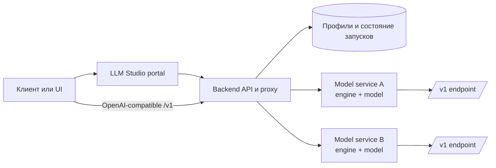

# LLM Studio

LLM Studio — планируемая платформа для поиска локальных движков и моделей,
управления запусками, наблюдения за метриками и доступа к запущенным моделям
через общий OpenAI-совместимый API.

Проект находится на этапе обсуждения первой версии. Черновик требований:
[спецификация Version Zero](docs/specs/2026-09-29-version-zero.md).
Правила локального запуска и развёртывания: [DEPLOYMENT_RULES.md](DEPLOYMENT_RULES.md).
Основа интерфейса — shadcn/ui: [дизайн-система и визуальный образец](docs/specs/2026-09-29-design-system.md).

Обычная разработка будет проходить в Docker на компьютере разработчика.
Основная серверная среда — Linux LXC на Proxmox с доступом по SSH.

## Архитектура запусков моделей

LLM Studio разделяет портал и запущенные модели. Портал отвечает за профили,
жизненный цикл процессов, мониторинг, логи и общий OpenAI-совместимый API.
Сама модель запускается отдельным процессом или сервисом движка и не является
частью процесса backend.

В нативной Linux/LXC-установке каждый запуск модели работает в отдельном
временном `systemd` unit. Поэтому перезапуск `llm-studio.service` не
перезапускает уже работающие модели: backend после восстановления снова видит
их, продолжает мониторинг и управляет ими. После перезагрузки самой ОС модели
не поднимаются автоматически, кроме профилей с включённым `autostart`.

В Docker используется process-режим. Модель также запускается отдельным
процессом внутри контейнера, но перезапуск или остановка самого контейнера
завершает дочерние процессы моделей. Подробности о восстановлении, `systemd`,
`autostart` и режимах запуска описаны в [lifecycle-документе](docs/model-process-lifecycle.md).

Главное следствие такой архитектуры: модельный процесс можно обновлять,
останавливать и наблюдать независимо от UI-портала, а внешний клиент всегда
обращается к единому API портала, а не напрямую к внутренним процессам.
